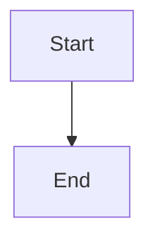

# Workflow Diagrams

This directory contains [Mermaid](https://mermaid.js.org/) diagrams that document the core platform workflows. Diagrams render natively in GitHub's Markdown viewer — no external tools or plugins required.

## Available Diagrams

| File | Description |
|------|-------------|
| [data-flow-layers.mmd](./data-flow-layers.mmd) | As-built ingestion, PostgreSQL, ORM, service, API and browser flow; schema control and planned semantic adoption |
| [data-page-consumers.mmd](./data-page-consumers.mmd) | Shared persisted data families mapped to API domains and actual React page families |
| [draft-flow.md](./draft-flow.md) | Auction draft flow — nomination, bidding, and roster assignment |
| [waiver-flow.md](./waiver-flow.md) | Waiver / FAAB processing — claim queue, sorting, and ledger deduction |
| [ledger-model.md](./ledger-model.md) | Ledger interaction model — how user actions create ledger entries and update balances |
| [simulation-pipeline.md](./simulation-pipeline.md) | Draft strategy simulation pipeline — Monte Carlo iterations and result aggregation |

## Reading the data-flow maps

These maps describe the code and source contracts available on the issue-554
worktree, not a verification of deployed database contents. Solid arrows show
data or request flow. Dashed, labeled arrows show schema-definition/control
relationships or planned semantic adoption, not an existing universal pipeline.
The consumer map groups representative dependencies; it is not an exhaustive
endpoint or column inventory.

`Base` in [`backend/database.py`](../../backend/database.py) is SQLAlchemy's
shared declarative registry. Models inherit from it and register table
definitions in `Base.metadata`; rows are read and written through models and
sessions, not transformed by `Base`. Published Alembic/bootstrap revisions own
schema changes. The legacy archive is recovery evidence, not the source for
ordinary page queries.

The intended boundary is router -> service -> ORM, but the current code also
has router-local queries and calculations. Similarly, not every response is
Pydantic-typed and not every page uses TanStack Query. The diagrams show those
as-built exceptions rather than presenting the desired architecture as complete.

The planned semantic work must distinguish provider identities from app IDs,
source-reported points from league-calculated points, current rosters from
historical ownership, and missing data from measured zero. A league's current
rules or season do not establish historical scoring context. See the
[semantic contract](../SEMANTIC_DATA_CONTRACT.md) and
[as-built source map](../SEMANTIC_DATA_SOURCE_MAP.md).

Evidence for the maps:

- [Database sessions and Base](../../backend/database.py),
  [domain models](../../backend/models.py), and
  [projection/value models](../../backend/models_draft_value.py).
- [Projection loader](../../etl/load/load_to_postgres.py),
  [live scoring ingestion](../../backend/services/live_scoring_ingest_service.py),
  [MFL importer](../../backend/scripts/import_mfl_csv.py), and
  [history enrichment](../../backend/services/league_history_enrichment_service.py).
- [React routes](../../frontend/src/App.jsx),
  [API/page inventory](../API_PAGE_MATRIX.md), and
  [frontend API helpers](../../frontend/src/api/).

Open either `.mmd` file with the Mermaid extension to preview and edit it.

## How to Edit Mermaid Diagrams

Mermaid diagrams are written as fenced code blocks with the `mermaid` language tag inside a Markdown file:

````markdown

````

### Editing Locally

1. Open any `.md` file in this directory with your preferred editor.
2. Modify the content inside the ` ```mermaid ` ... ` ``` ` block.
3. Use the [Mermaid Live Editor](https://mermaid.live/) to preview and validate your changes before committing.

### Editing on GitHub

1. Open the file on GitHub and click the pencil (✏️) icon to edit.
2. GitHub will render a live preview of the diagram in the **Preview** tab.
3. Commit your changes directly from the browser.

### Diagram Types Used

| Diagram | Type | Keyword |
|---------|------|---------|
| Draft Flow | Top-down flowchart | `flowchart TD` |
| Waiver Flow | Top-down flowchart | `flowchart TD` |
| Ledger Model | Left-to-right flowchart | `flowchart LR` |
| Simulation Pipeline | Top-down flowchart | `flowchart TD` |

### Common Syntax Reference

```
flowchart TD          # Top-down direction (also: LR = left-right, BT = bottom-top)

A[Rectangle]          # Node with rectangle shape
B{Diamond}            # Decision node (diamond shape)
C([Rounded])          # Node with rounded corners

A --> B               # Solid arrow
A -->|Label| B        # Labeled arrow
A --- B               # Line without arrowhead
```

For the full Mermaid syntax reference, see the [official documentation](https://mermaid.js.org/syntax/flowchart.html).

## Guidelines

- Keep diagrams simple and focused on a single workflow.
- Use plain ASCII labels to ensure compatibility with GitHub's Mermaid renderer.
- Avoid advanced Mermaid features (subgraphs with complex styling, `%%{init}%%` directives) that may not render on GitHub's free tier.
- All diagrams are version-controlled — treat them like code and open a PR for changes.
